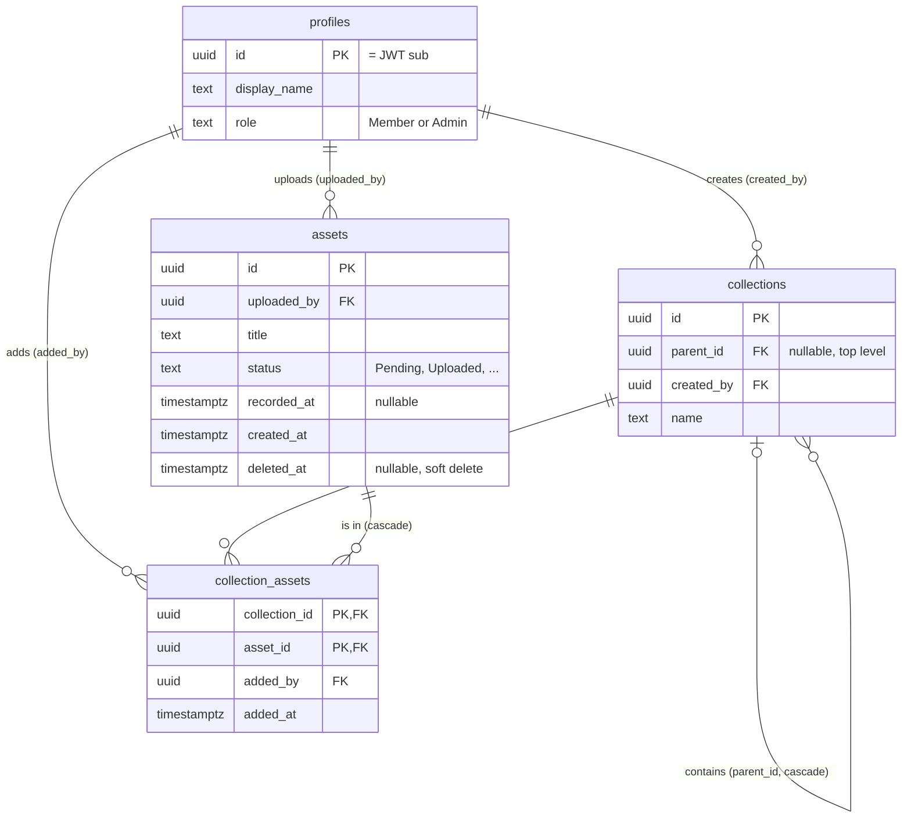

# Data model

**Status:** Draft for the parts not built yet (favorites, share links). Settled decisions are marked ✅, and things still being considered are listed under
_Open questions_.

## Settled

- ✅ **Shared library.** Every invited user sees everything. `uploaded_by` / `created_by` are for
  attribution and edit/delete rights, not visibility.
- ✅ **No tags** for now.
- ✅ **Storage keys, not URLs**, are stored. The API returns short-lived signed URLs. Keys are derived from
  the asset ID (`assets/{id}/original`), never from filenames.
- ✅ **UUID v7** IDs (`Guid.CreateVersion7()`).
- ✅ **Soft delete** via `deleted_at`. `status` describes the upload/processing lifecycle only.
- ✅ **Status stored as text** (`HasConversion<string>()`), so new states don't require data migrations.
- ✅ **Generic collection tree + `recorded_at`.** Separate `Game` and `Session` entities were considered
  and rejected as too specific.
- ✅ **Tree depth is capped at 5 levels** (in addition to rejecting cycles). Can be lowered if it causes
  problems.
- ✅ **Deleting a collection deletes its sub-collections too.** Clips are never deleted.
- ✅ **Originals are deleted once processing succeeds**, controlled by a setting (default: delete).
- ✅ **Share links are for single assets only.** Sharing collections was considered and dropped as too
  much work for too little benefit.
- ✅ **Roles and permissions:** `profiles.role` is `Member` or `Admin`. Owners edit and delete their own
  clips and collections, admins everything. Collections are shared: anyone can add and remove clips and
  create sub-collections in any collection. See [0003](decisions/0003-authentication-and-permissions.md).
- ✅ **Clips in a collection are sorted, not manually ordered.** Sort options (recorded, uploaded, title)
  cover the need and fit the "sessions" view grouped by `recorded_at`. Manual ordering can be added later
  with a `position` column if it's missed.
- ✅ **Favorites are visible to everyone.** Each user has their own favorites, and others can see who
  favorited what (e.g. "3 people favorited this").

## Schema

`profiles`, `assets`, `collections` and `collection_assets` exist; the entities in `Curator.Domain` and their EF
configuration in `Curator.Infrastructure` are the source of truth for them. The other tables and columns are
still proposed. `?` marks a nullable column.

The tables that exist, with their keys and a few columns that explain them (all columns are in the list below):



```
profiles           id (= JWT sub), display_name, role, created_at

assets             id, uploaded_by → profiles, title, description?,
                   original_filename, content_type, status,
                   source_key?, source_size_bytes,
                   playback_key?, playback_size_bytes?,
                   thumbnail_key? (versioned, ADR 0006), processing_error?,
                   duration_ms?, width?, height?, recorded_at?,
                   created_at, updated_at, deleted_at?

collections        id, parent_id? → collections (cascade), created_by → profiles,
                   name, description?, created_at, updated_at

collection_assets  collection_id → collections (cascade), asset_id → assets (cascade),
                   added_by → profiles, added_at
                   PK (collection_id, asset_id)

favorites          (later) profile_id, asset_id, created_at
                   PK (profile_id, asset_id)

share_links        (later) id, token (unique), asset_id, created_by,
                   expires_at, revoked_at, created_at
```

### Asset lifecycle

```
Pending → Uploaded → Processing → Ready
   └──────────┴───────────┴──────→ Failed
```

1. The API creates the asset (`Pending`) and returns a presigned R2 upload URL.
2. The browser uploads straight to R2, then tells the API it's done (`Uploaded`).
3. A worker transcodes the original into a smaller playback version and creates a thumbnail
   (`Processing` → `Ready`, or `Failed` with `processing_error`).
4. Once the asset is `Ready`, the worker deletes the original and clears `source_key`, unless the
   `KeepOriginals` setting is on. `source_size_bytes` is kept for reference. Failed assets keep their
   original so processing can be retried.

`recorded_at` is when the clip was captured. The browser sends `File.lastModified` on upload, and
processing can correct it from the video's metadata. Neither is reliable (downloading or copying a file resets
its modification time, and many tools don't write or keep `creation_time`), so the uploader or an admin can
also edit it (`PATCH /assets/{id}`).

- [ ] With processing: don't let metadata overwrite a time someone set by hand. For example a
      `recorded_at_source` (`Browser`, `Metadata`, `Manual`), where only `Browser` is replaced.

### Collections

How the tree is stored, checked, locked and read is in [0007](decisions/0007-collection-tree.md).

- A generic tree using `parent_id`. Nothing in it is game- or session-specific: "Best of 2026 → Screams"
  and "R.E.P.O → Funny moments" are the same thing.
- Max depth is 5. The domain rejects cycles (moving a collection into one of its own descendants) and
  moves or creates that would exceed the depth (target depth + height of the moved subtree).
- A clip is stored only in the collections it was explicitly added to, and can be in several.
  "Show clips from sub-collections too" is a display option (`GET /assets?collectionId=…&includeSubCollections=true`),
  not duplicated data.
- The app shows the tree as a sidebar. Selecting a collection shows its clips; collections aren't mixed in
  with clips in the grid. So the API lists the whole tree once (`GET /collections`) rather than a level at a
  time.
- "Sessions" are a view: the clips in a collection grouped by `recorded_at`, not a structure.
- Sub-collections sort by name. The draft's `position` column for a manual order was dropped, as for clips;
  add it if a manual order is missed.
- No covers for now (decided 2026-10-19): neither an uploaded image nor a clip's thumbnail. If covers are
  wanted later, a chosen clip (`cover_asset_id`) reuses thumbnails and needs no image uploads.
- Deleting a collection deletes all of its sub-collections and their `collection_assets` rows. The clips
  themselves stay in the library. The UI should confirm with a count of affected sub-collections.

## Open questions

- [ ] Favorites: assets only (as drafted), or collections too?
